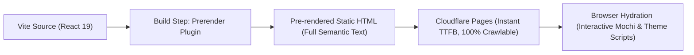
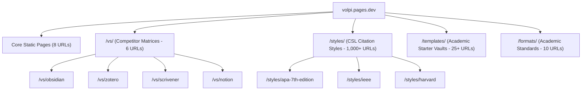
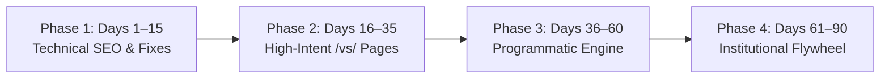
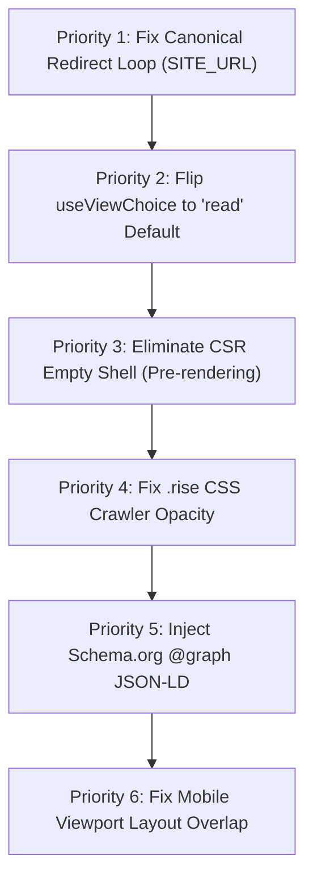
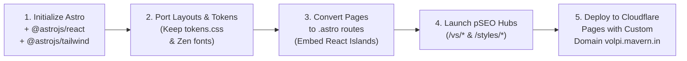

# SEO Volpi Strategies: Comprehensive Technical Audit & Organic Growth Blueprint

**Product:** Volpi (v0.1.1 Open Beta) — A Local-First Research Desk  
**Target Audience:** PhD Students, Academic Researchers, Postdocs, Independent Scholars  
**Core Stack:** Tauri 2 (Rust + React desktop app) / Vite + React 19 + Tailwind CSS (Website)  
**Audit Scope:** Read-Only Visual, Textual, Technical & Architectural Review of `./Development/Volpi Website`  
**Date:** October 2026  

---

## Executive Summary & Visual Audit Findings

Volpi is positioned as a **local-first desktop research workstation** that unifies PDF reading/highlighting, bidirectional linked Markdown notes, tabular data auditing and charting (CSV/TSV/JSON), reference verification against scholarly databases (Crossref, OpenAlex, arXiv, PubMed), and distraction-free academic paper drafting with live citations.

The brand identity (*"Mochi Mochi UI"* / *"The Quiet Scholar"*) blends warm paper tones (`#f4efe4`), crisp ink outlines, screentone shading, and the guide mascot **Mochi**. While visually distinctive and emotionally engaging, our deep audit revealed **critical architectural SEO blindspots, rendering traps, and indexing barriers** that severely limit organic discoverability.

```
┌────────────────────────────────────────────────────────────────────────────────────────┐
│                                 VOLPI WEBSITE AUDIT SUMMARY                             │
├──────────────────────────────┬───────────────────────────────┬─────────────────────────┤
│ Core Dimension               │ Current State                 │ Impact Rating           │
├──────────────────────────────┼───────────────────────────────┼─────────────────────────┤
│ Rendering Architecture       │ Client-Side Rendering (CSR)   │ 🔴 CRITICAL FLAW        │
│ Default View Logic           │ "Watch" mode unmounts content │ 🔴 CRITICAL FLAW        │
│ Structured Data (Schema.org) │ None (0 schemas present)      │ 🔴 HIGH OPPORTUNITY     │
│ Programmatic SEO (pSEO)      │ None (only 8 static pages)    │ 🔴 HIGH OPPORTUNITY     │
│ Meta & Social Tags           │ Incomplete head metadata      │ 🟡 MEDIUM DEFICIENCY    │
│ Scroll Animation (.rise)     │ Initial opacity: 0 via CSS    │ 🟡 CRAWLER RISK         │
│ Brand Calibration            │ Mascot overshadows desk tool  │ 🟡 CONVERSION FRICTION  │
└──────────────────────────────┴───────────────────────────────┴─────────────────────────┘
```

---

## 1. Visual & Page Review (Screen-by-Screen Teardown)

The website consists of eight core routes built with individual HTML entry points in Vite. Below is the visual and textual assessment based on full-resolution renders captured directly from the live build.

### 1.1 Home Page (`/`)
* **Visual Identity:** Warm paper backdrop, Zen Old Mincho serif typography, fox seal stamp in vermilion red (`#c0383e`), and Mochi peeking from behind the badge.
* **Hero Messaging:** *"For researchers with too many tabs open."* — Relatable and empathetic, supported by the two-sentence bridge explaining local-first storage.
* **The "Unmounting" Trap:** By default, `useViewChoice` sets `view = 'watch'`. The visitor is presented with an 11-slide manga comic player (`<MochiTour />`). Crucial conversion and keyword sections—**Formats Band, Who It's For, Principles, Research Loop, Themes, Why Local, and Not Yet**—are completely removed from the DOM!
* **Read-Mode vs. Watch-Mode Comparison:**
  * In *Watch Mode*: Page height is ~4,200px; contains minimal crawlable keyword text.
  * In *Read Mode*: Page height expands to ~8,900px; displays deep scholarly workflow diagrams, formats (`BibTeX`, `Crossref`, `OpenAlex`, `APA`, `IEEE`), pain-point cards, and data validation tools.


### 1.2 Features Page (`/features/`)
* **Current Structure:** Contains seven in-depth chapters (Projects, PDFs, Notes & Links, References, Data & Charts, Writing, Library & Search).
* **The Indexing Blocker:** Exactly like the homepage, `features/index.html` loads `<FilmSection />` by default ("The Features Show, by Mochi"). The 15,145px long-form documentation blocks containing screenshots, workflow walkthroughs, and technical feature tables are hidden behind a user click.
* **Visual Quality:** In read mode, the feature blocks feature clear side-by-side screenshots, honest limitations, and links to relevant documentation anchors.


### 1.3 Documentation (`/docs/`)
* **Strengths:** Outstanding technical density. Covers installation per OS (Windows, macOS Intel/ARM, Linux .deb/.rpm), keyboard shortcuts (`Ctrl+/`), glossary, link syntax, file formats, and reference check databases.
* **SEO Weakness:** Single 14,700px monolithic page. It contains answers to dozens of distinct search queries (e.g., *"how to cite PubMed in markdown"*, *"extract tables from PDF as CSV"*, *"compare file versions offline"*) that are trapped on one URL instead of dedicated, rankable sub-guides.


### 1.4 Pricing (`/pricing/`), Roadmap (`/roadmap/`), About (`/about/`), and Privacy (`/privacy/`)
* **Pricing:** Clearly communicates "Free open beta" and "Version 1.0 will be a one-time purchase, not a subscription." Excellent ethical framing against subscription fatigue.
* **Roadmap:** Phase-based progression (v0.1.0 out, v0.1.1 current, Phase 1.5 polish, Phase 2 extensions, Phase 3 local ML models).
* **About:** Features the founder's letter (*"Dear fellow researcher..."* by Mavem). Highly authentic, building personal trust.
* **Privacy:** Comprehensive breakdown of scholarly APIs queried (Crossref, OpenAlex, arXiv, PubMed) and explicit confirmation of zero telemetry and zero cloud lock-in.

---

## 2. Technical SEO Audit: The Core Deficiencies

### 2.1 The "Empty Shell" CSR Bottleneck
Although each page has its own HTML shell (`about/index.html`, `docs/index.html`, etc.), the actual body served by Cloudflare Pages is:

```html
<body>
  <div id="root"></div>
  <script type="module" src="/src/entries/home.tsx"></script>
</body>
```

> [!WARNING]
> **Crawler Impact:**
> 1. Non-JavaScript bots (Bingbot, DuckDuckGo, Baidu, Yandex, Applebot) and modern AI search engines (Perplexity, ChatGPT Search, Claude bot) receive an empty DOM.
> 2. Social scrapers (Discord, Slack, LinkedIn, Twitter) only see the hardcoded head tags and cannot extract in-page context.
> 3. Googlebot queues JavaScript execution in its Web Rendering Service (WRS), causing indexation delays of days to weeks.

### 2.2 The `useViewChoice` Default Unmounting Bug
In `src/hooks/useViewChoice.ts`:
```typescript
const [choice, setChoice] = useState<ViewChoice>(() => 
  (readJSON(key, { view: 'watch' }).view === 'read' ? 'read' : 'watch')
);
```
Because the fallback state is `'watch'`, search engine renderers execute the script and render only the Mochi comic carousel. Over **80% of the site's semantic text, keyword occurrences, and feature documentation are excluded from the initial DOM tree**.

### 2.3 The CSS `.rise` Opacity Trap
In `src/styles/animations.css`:
```css
.rise { 
  opacity: 0; 
  transform: translate3d(0, 14px, 0); 
  transition: opacity .5s ease, transform .5s ease; 
}
.rise.is-in { 
  opacity: 1; 
  transform: none; 
}
```
Elements only receive `.is-in` when scrolled past an `IntersectionObserver` threshold. If an automated crawler takes a snapshot of the rendered page without simulating complete scroll events, content outside the initial 1080px viewport remains at `opacity: 0`.

### 2.4 Total Lack of Schema.org Structured Data
There is zero JSON-LD in the HTML headers. Google SERPs have no structured understanding of:
- Volpi's operating system support (macOS, Windows, Linux).
- Application category (`ProductivityApplication`, `ResearchSoftware`).
- License & Price (`Offer: $0` during beta).
- Frequently Asked Questions.

### 2.5 Metadata & Canonical Hygiene
- The source HTML files lack canonical tags (they are injected during `vite build` via `siteMeta()`, but lack Twitter Card titles/descriptions and Open Graph types).
- Mobile layout experiences visual collisions: on viewports under 400px width, the absolute-positioned Mochi head overlaps the hero trust badge text.

---

## 3. Competitive Landscape & Architectural Benchmark

Our deep research into competitive and adjacent research tools revealed key strategic insights:

```
┌────────────────────────────────────────────────────────────────────────────────────────┐
│                              COMPETITIVE SEO BENCHMARK MATRIX                          │
├───────────────┬──────────────────────────┬─────────────────────────┬───────────────────┤
│ Competitor    │ Primary Organic Engine   │ Schema.org Strategy     │ Programmatic Scale│
├───────────────┼──────────────────────────┼─────────────────────────┼───────────────────┤
│ **Obsidian**  │ Community Plugins/Themes │ Minimal / Basic         │ 1,500+ plugin URLs│
│ **Zotero**    │ CSL Citation Repository  │ LibGuides & Forum SEO   │ 10,000+ CSL styles│
│ **AFFiNE**    │ Head-to-Head Comparisons │ Full @graph JSON-LD     │ 2,100+ pages      │
│ **Scrivener** │ Academic / Novel Landing │ SoftwareApplication/Edu │ High Brand Auth   │
│ **Notion**    │ Template Marketplace     │ UGC Community Indexing  │ 30,000+ templates │
│ **Volpi**     │ *Currently Missing*      │ *0 Schemas*             │ *8 Static Pages*  │
└───────────────┴──────────────────────────┴─────────────────────────┴───────────────────┘
```

### Strategic Takeaways for Volpi:
1. **The Zotero Playbook:** Zotero captures massive organic traffic from academic queries like *"cite APA 7th edition"* because it hosts the open-source Citation Style Language directory. Volpi already supports APA, IEEE, MLA, Chicago, Harvard, and Vancouver—this can be expanded programmatically.
2. **The AFFiNE Playbook:** Direct comparison matrices (`/vs/obsidian`, `/vs/zotero`, `/vs/notion`, `/vs/scrivener`) capture high-intent users actively looking to replace bloated cloud or fragmented setups.
3. **The Obsidian Playbook:** Local-first Markdown positioning resonates deeply with privacy-conscious researchers seeking data sovereignty.

---

## 4. Architectural Alternatives: Design & Branding Calibration

### 4.1 Under-Branding vs. Over-Branding: "The Cuteness Dilemma"
In `VOLPI_WEBSITE_MASTER_STRATEGY.md`, the documented brand strategy was:
> *"The positioning trap to avoid: The opposite trap is a 'cosy' site so decorative that it stops looking serious... The fox seal as logo and favicon. Mochi appears at most once, as a small easter egg."*

However, the actual live implementation places Mochi at the center of nearly every interaction:
- Hero: Mochi peeking over the seal.
- Home: 11-slide comic tour.
- Features: 13-slide features show.
- About: Mochi tells the origin story.
- Privacy: Mochi acts out privacy policies.

```
       [ OVER-BRANDED ]
       Mochi mascot dominates every page;
       academic researchers fear it is a toy.
               ▲
               │       ★ RECOMMENDED EQUILIBRIUM:
               │       "THE QUIET SCHOLAR"
               │       Paper & ink elegance, scholarly tools front and center;
               │       Mochi as an optional, charming assistant.
               │
[ UNDER-BRANDED ] ─────────────────────────► [ BALANCED & AUTHORITATIVE ]
Generic purple SaaS;                         High-credibility research workstation;
looks like developer tooling.                reproducible data, plain files, real workflows.
```

> [!IMPORTANT]
> **Design Recommendation:**
> 1. **Default to "Read the Page":** Show the actual research desk, data audit tables, and reference workflows immediately.
> 2. **Refactor Mochi to a "Sidecar" Companion:** Allow Mochi to provide contextual tips (e.g., in a corner bubble or expandable tray) rather than supplanting the entire page layout.
> 3. **Preserve Mochi Mochi UI Tokens:** The warm paper (`#f4efe4`), ink outlines, screentone textures, and Zen Old Mincho fonts are exceptional assets—keep them intact.

---

## 5. Technical SEO & Schema.org Implementation Blueprint

### 5.1 Static Site Generation (SSG) Architecture
To eliminate the empty client-side shell while maintaining Vite tooling, transition from purely client-rendered entry scripts to pre-rendering:



#### Recommended Options:
- **Option A (Zero Config Change):** Use `@prerenderer/rollup` or `vite-plugin-prerender` to crawl the 8 routes at build time and output full HTML.
- **Option B (Next-Gen SSG):** Use **Astro** with React islands for interactive components (`client:visible` for video loops and Mochi rigs).

### 5.2 Complete Production JSON-LD `@graph` Schema
Add this structured data script to `index.html` (and dynamically customize per sub-page):

```html
<script type="application/ld+json">
{
  "@context": "https://schema.org",
  "@graph": [
    {
      "@type": "Organization",
      "@id": "https://volpi.pages.dev/#organization",
      "name": "Volpi",
      "url": "https://volpi.pages.dev",
      "logo": {
        "@type": "ImageObject",
        "@id": "https://volpi.pages.dev/#logo",
        "url": "https://volpi.pages.dev/assets/brand/fox-seal.svg",
        "caption": "Volpi Fox Seal"
      },
      "sameAs": [
        "https://github.com/Phantom-Con-Artist/Volpi-Documentations",
        "https://github.com/Phantom-Con-Artist/Volpi-Releases",
        "https://x.com/MochiVolpi",
        "https://discord.gg/gkHMSq6emT"
      ]
    },
    {
      "@type": "WebSite",
      "@id": "https://volpi.pages.dev/#website",
      "url": "https://volpi.pages.dev",
      "name": "Volpi",
      "description": "A quiet, local-first research desk for reading PDFs, linking notes, and writing papers.",
      "publisher": { "@id": "https://volpi.pages.dev/#organization" }
    },
    {
      "@type": "SoftwareApplication",
      "@id": "https://volpi.pages.dev/#software",
      "name": "Volpi",
      "applicationCategory": "ProductivityApplication",
      "applicationSubCategory": "Academic Research & Reference Management Software",
      "operatingSystem": "Windows 10/11, macOS 12+ (Apple Silicon & Intel), Linux (Debian, Ubuntu, Fedora, openSUSE)",
      "softwareVersion": "0.1.1",
      "downloadUrl": "https://github.com/Phantom-Con-Artist/Volpi-Releases/releases/latest",
      "featureList": [
        "Local-first folder architecture with Markdown and plain HTML notes",
        "PDF reading, highlighting, and note annotation without touching originals",
        "Automated reference verification against Crossref, OpenAlex, arXiv, and PubMed",
        "Tabular data validation (CSV, TSV, JSON) and SVG charting",
        "Academic paper writing with live citations, equations, and multi-format export",
        "Full version history with visual diffs and zero cloud lock-in"
      ],
      "offers": {
        "@type": "Offer",
        "name": "Open Beta",
        "price": "0",
        "priceCurrency": "USD",
        "availability": "https://schema.org/InStock",
        "description": "Free open beta for all platforms."
      },
      "author": { "@id": "https://volpi.pages.dev/#organization" }
    },
    {
      "@type": "FAQPage",
      "@id": "https://volpi.pages.dev/#faq",
      "isPartOf": { "@id": "https://volpi.pages.dev/#website" },
      "mainEntity": [
        {
          "@type": "Question",
          "name": "Where does Volpi store my research data?",
          "acceptedAnswer": {
            "@type": "Answer",
            "text": "Every Volpi project is a plain folder on your own computer. Notes are standard Markdown, papers are readable HTML, and highlights are kept in small companion files beside the PDF. Volpi has no accounts, no cloud database, and no telemetry."
          }
        },
        {
          "@type": "Question",
          "name": "Does Volpi require an internet connection?",
          "acceptedAnswer": {
            "@type": "Answer",
            "text": "Volpi is completely functional offline. The only network access occurs when you verify citations against public scholarly databases (Crossref, OpenAlex, arXiv, PubMed) or check for app updates, both of which can be turned off."
          }
        },
        {
          "@type": "Question",
          "name": "What will Volpi cost after the beta?",
          "acceptedAnswer": {
            "@type": "Answer",
            "text": "Volpi 1.0 will be a one-time purchase with no recurring monthly subscriptions. The open beta is free to download for Windows, macOS, and Linux."
          }
        }
      ]
    }
  ]
}
</script>
```

---

## 6. Programmatic SEO (pSEO) Expansion Strategy

Volpi currently has 8 indexable URLs. To build an organic search moat comparable to Zotero, Obsidian, and Notion, implement four programmatic hubs:



### 6.1 Hub 1: Head-to-Head Comparison Pages (`/vs/*`)
Target high-intent search queries from researchers evaluating tools:
1. `/vs/obsidian` — *Volpi vs. Obsidian for Academic Research: Built-in PDF Annotations & Citations without Community Plugin Fragility*
2. `/vs/zotero` — *Volpi vs. Zotero: Modern UI, Integrated Markdown Notes, and Tabular Data Charting*
3. `/vs/scrivener` — *Volpi vs. Scrivener: Local Plaintext vs. Proprietary Bundles for Thesis Writing*
4. `/vs/notion` — *Volpi vs. Notion: Why Privacy-Conscious Academics are Moving to Local-First Markdown*
5. `/vs/logseq` — *Volpi vs. Logseq: Document-Centric Writing vs. Strict Outliners*

### 6.2 Hub 2: The Citation Style Repository (`/styles/*`)
- **Opportunity:** The open-source Citation Style Language (CSL) repository contains over 10,000 citation styles.
- **Implementation:** Generate programmatic static landing pages for popular journal styles (e.g., `/styles/nature`, `/styles/ieee`, `/styles/apa-7th-edition`, `/styles/cell`).
- **Page Contents:**
  - In-browser interactive preview of citations (Article, Book, Conference, Website).
  - One-click copy of BibTeX snippet.
  - "Open in Volpi" deep link.

### 6.3 Hub 3: Academic Research Vault Templates (`/templates/*`)
Researchers constantly search for structured note-taking frameworks:
- `/templates/phd-literature-review-matrix`
- `/templates/systematic-review-prisma-workflow`
- `/templates/empirical-study-lab-notebook`
- `/templates/dissertation-outline-scrivener-style`
- `/templates/zettelkasten-academic-starter`

Each page offers a downloadable `.zip` project folder that opens directly as a Volpi research branch.

---

## 7. Developer & Academic Distribution Channels

Academics and technical knowledge workers discover software through institutional recommendations and package managers:

### 7.1 University LibGuides Integration (.edu Backlink Flywheel)
- **Mechanism:** Over 5,000 academic libraries utilize Springshare LibGuides (`libguides.mit.edu`, `guides.library.harvard.edu`, etc.).
- **Strategy:** Provide academic librarians with free, open educational resources: *"Guide to Reproducible Research & Local-First Literature Management"*.
- **Target Librarians:** Digital Scholarship, Research Data Management, and Health Sciences reference librarians.

### 7.2 Package Manager Entries (Direct Install Query Domination)
Technical researchers expect terminal installations:
- **macOS:** Submit Cask to `homebrew/cask` (`brew install --cask volpi`).
- **Windows:** Submit manifest to `microsoft/winget-pkgs` (`winget install volpi`).
- **Linux:** Publish to Flathub (`flatpak install org.volpi.Volpi`), Arch AUR (`aur/volpi-bin`), and Ubuntu PPA.
- **SEO Benefit:** Registry pages on `brew.sh`, `flathub.org`, and `aur.archlinux.org` generate permanent, high-authority domain authority backlinks.

### 7.3 Community Seeding
- **Reddit:** Authentic participation in `r/PhD`, `r/GradSchool`, `r/Zotero`, `r/ObsidianMD`, `r/PKMS`. Share reproducible workflows (e.g., *"How I tracked 300 PDF citations for my dissertation without cloud sync"*).
- **Academic Socials:** Post workflow demonstrations on Bluesky and Mastodon using `#AcademicChatter` and `#OpenScience`.

---

## 8. Prioritized 90-Day Implementation Roadmap



| Phase | Window | Focus Area | High-Impact Action Items |
| :--- | :--- | :--- | :--- |
| **Phase 1** | Days 1–15 | **Critical Bug Fixes & Pre-rendering** | 1. Change default in `useViewChoice.ts` to `'read'`.<br>2. Implement SSG pre-rendering build step.<br>3. Add complete JSON-LD `@graph` schema.<br>4. Fix mobile viewport Mochi overlap.<br>5. Ensure `.rise` elements have fallback opacity for bots. |
| **Phase 2** | Days 16–35 | **Conversion & Competitor Hubs** | 1. Launch `/vs/obsidian`, `/vs/zotero`, `/vs/notion`, and `/vs/scrivener`.<br>2. Break monolithic `/docs/` into category anchors with sub-sitemaps.<br>3. Add platform detection hook to download CTA. |
| **Phase 3** | Days 36–60 | **Programmatic SEO Engine** | 1. Build CSL citation style directory (`/styles/[slug]`).<br>2. Build Academic Starter Vaults (`/templates/[slug]`).<br>3. Automate Open Graph image generation using SVG edge cards. |
| **Phase 4** | Days 61–90 | **Academic & CLI Distribution** | 1. Submit packages to Homebrew Cask, Winget, and Flathub.<br>2. Launch university library outreach campaign for LibGuides listings.<br>3. Publish GitHub Awesome List PRs (`awesome-pkm`, `awesome-local-first`). |

---

## 9. Deferred Items & Open Decisions

In accordance with project instructions, the following items are flagged as **DEFERRED** pending external confirmation:

1. `[DEFERRED: Paid Search & Acquisition]` — Google Ads and paid promotion strategy is deferred until v1.0 monetization and conversion funnels are established.
2. `[DEFERRED: Multi-tier Pricing Schema]` — Commercial license pricing (student discount, lab license, commercial tier) is deferred until v1.0 pricing announcement.
3. `[DEFERRED: Multi-Device Sync Architecture]` — Cloud sync and collaborative editing SEO is deferred; Volpi remains strictly single-device local-first for Beta 0.1.1.
4. `[DEFERRED: Native Browser Extension]` — Dedicated web clipper extension pages (`/clipper`) deferred until Tauri web extension bridge is scoped in Phase 2 roadmap.

---

## 10. Top Immediate Priorities (Actionable Checklist)

To achieve rapid SEO gains and resolve critical crawlability bottlenecks, execute these priorities in order of impact:



### Priority 1: Resolve the Canonical Redirect Loop
* **Issue:** Cloudflare has an active **HTTP 308 Permanent Redirect** from `volpi.pages.dev` to `volpi.mavern.in`. However, [`vite.config.ts`](file:///home/subhradeep/Development/Volpi%20Website/vite.config.ts#L7) sets `SITE_URL = 'https://volpi.pages.dev'`, causing HTML headers to declare `volpi.pages.dev` as canonical.
* **The Conflict:** `volpi.mavern.in` tells search engines that its canonical version is `volpi.pages.dev`, while `volpi.pages.dev` permanently redirects back to `volpi.mavern.in`.
* **Action:** Update line 7 in [`vite.config.ts`](file:///home/subhradeep/Development/Volpi%20Website/vite.config.ts#L7):
  ```diff
  - const SITE_URL = 'https://volpi.pages.dev';
  + const SITE_URL = 'https://volpi.mavern.in';
  ```
* **Impact:** Canonical tags, `sitemap.xml`, and Open Graph tags immediately align with the 308 redirect, concentrating 100% of domain equity into `volpi.mavern.in`.

### Priority 2: Flip `useViewChoice` Default to "Read Mode"
* **Issue:** In [`src/hooks/useViewChoice.ts`](file:///home/subhradeep/Development/Volpi%20Website/src/hooks/useViewChoice.ts#L13), `useViewChoice` defaults to `'watch'`. On Home, Features, and Privacy, the core product sections (Formats Band, Target Audience, Research Loop, Feature Chapters) are completely unmounted and replaced by an interactive comic player.
* **Action:** Update line 13 in [`src/hooks/useViewChoice.ts`](file:///home/subhradeep/Development/Volpi%20Website/src/hooks/useViewChoice.ts#L13):
  ```diff
  - const [choice, setChoice] = useState<ViewChoice>(() => (readJSON(key, { view: 'watch' }).view === 'read' ? 'read' : 'watch'));
  + const [choice, setChoice] = useState<ViewChoice>(() => (readJSON(key, { view: 'read' }).view === 'watch' ? 'watch' : 'read'));
  ```
* **Impact:** Instantly exposes over 8,900px of keyword-rich copy, formats (`BibTeX`, `Crossref`, `OpenAlex`, `APA`, `IEEE`), and data tools to search crawlers by default.

### Priority 3: Eliminate the Empty Shell CSR Defect
* **Issue:** Every built HTML shell in `dist/` contains only `<div id="root"></div>`. Non-JavaScript search engines (Bingbot, DuckDuckGo, Baidu) and AI crawlers (Perplexity, ChatGPT Search, Claude bot) receive an empty DOM.
* **Action:** Implement build-time pre-rendering (via `@prerenderer/rollup`, `react-dom/server` `renderToString`, or the recommended Astro migration below) so that `dist/*.html` files ship with complete semantic DOM trees.
* **Impact:** Instant indexing across all search engines without relying on Googlebot's delayed Web Rendering Service (WRS).

### Priority 4: Fix the `.rise` Opacity Blocker for Bots
* **Issue:** CSS rule `.rise { opacity: 0; transform: translate3d(0, 14px, 0); }` keeps elements hidden until an `IntersectionObserver` scroll event triggers `.is-in`. Headless crawlers that snapshot without scrolling can register content as hidden or invisible.
* **Action:** In [`src/styles/animations.css`](file:///home/subhradeep/Development/Volpi%20Website/src/styles/animations.css#L2):
  ```diff
  - .rise { opacity: 0; transform: translate3d(0, 14px, 0); transition: opacity .5s ease, transform .5s ease; }
  + .rise { opacity: 1; transform: none; }
  + @media (prefers-reduced-motion: no-preference) {
  +   .js-active .rise:not(.is-in) { opacity: 0; transform: translate3d(0, 14px, 0); transition: opacity .5s ease, transform .5s ease; }
  + }
  ```
* **Impact:** Ensures crawlers and no-JS visitors see full opacity while preserving smooth reveal transitions for interactive users.

### Priority 5: Inject Schema.org `@graph` JSON-LD
* **Action:** Embed the complete production `SoftwareApplication`, `WebSite`, `Organization`, and `FAQPage` schema (detailed in Section 5.2) into the root `<head>`.
* **Impact:** Activates Google SERP Rich Snippets, Software badges, OS availability listings, and FAQ dropdowns.

### Priority 6: Resolve Mobile Viewport Collisions
* **Issue:** On viewports under 400px width (e.g., iPhone 390px), the absolute-positioned Mochi head overlaps the hero trust note ("The beta installers are not signed yet...").
* **Action:** Add responsive breakpoints or hide decorative floating elements on mobile viewports under `sm` (`640px`).

---

## 11. Strategic Migration Blueprint: Migrating to Astro for Maximum Visibility

If your objective is **maximum organic visibility and domain scale**, migrating from a pure Vite SPA to **Astro** is the most effective architectural upgrade.

### 11.1 Why Astro Outperforms Next.js for Volpi

```
┌────────────────────────────────────────────────────────────────────────────────────────┐
│                              ASTRO VS NEXT.JS ARCHITECTURAL FIT                         │
├──────────────────────────────┬───────────────────────────────┬─────────────────────────┤
│ Dimension                    │ Next.js (App Router)          │ Astro (Islands)         │
├──────────────────────────────┼───────────────────────────────┼─────────────────────────┤
│ JavaScript Footprint         │ Ships React + Next runtime    │ **0 KB JS by default**  │
│ Cloudflare Pages Hosting     │ Requires `output: 'export'`   │ **Native Static Build** │
│ Core Web Vitals (LCP / INP)  │ High hydration overhead       │ **Near-instantaneous**  │
│ React 19 Component Reuse     │ Complex `'use client'` splits │ **100% Drop-in Islands**│
│ Programmatic Content (pSEO)  │ Good, but runtime-heavy       │ **Best-in-class MDX**   │
└──────────────────────────────┴───────────────────────────────┴─────────────────────────┘
```

> [!TIP]
> **Why Not Next.js?**  
> On Cloudflare Pages without a Node.js server, Next.js must be configured with `output: 'export'`. This disables Server Actions and dynamic edge middleware, reducing Next.js to an unwieldy static site generator that still forces client-side React hydration on pure text pages. Astro was built specifically for content-first, zero-JS static performance on Cloudflare Pages.

### 11.2 Core Benefits of Astro for Volpi

1. **Zero JavaScript by Default:**  
   Every headline, paragraph, feature table, and citation guide is output as pure HTML and CSS. Googlebot, Bingbot, Perplexity, and Claude bot parse the exact text instantly with zero crawl budget wasted on JS execution.
2. **React 19 Islands Architecture:**  
   You do **not** need to rewrite any components. Your existing React components (`ThemedImg`, `LoopVideo`, `MochiRig`, `ViewSwitch`) are imported directly via `@astrojs/react` and hydrated only where needed:
   ```astro
   ---
   // src/pages/features.astro
   import BaseLayout from '../layouts/BaseLayout.astro';
   import { LoopVideo } from '../components/media/LoopVideo';
   import { MochiRig } from '../components/mochi/rig/MochiRig';
   import { FEATURE_CHAPTERS } from '../content/features.content';
   ---
   <BaseLayout title="Features · Volpi">
     <!-- Rendered as pure static HTML (0 KB JS shipped) -->
     <header>
       <h1>Everything Volpi does.</h1>
     </header>

     <!-- React component hydrated ONLY when scrolled into view -->
     <LoopVideo client:visible clip={chapter.clips[0]} />
     
     <!-- Mochi interactive rig loaded when idle -->
     <MochiRig client:idle />
   </BaseLayout>
   ```
3. **Type-Safe Content Collections (Zod Schema Validation):**  
   Documentation chapters, release notes, and future comparison pages live in structured Markdown or YAML files with strict compile-time type safety.
4. **Programmatic SEO (pSEO) Engine:**  
   Astro’s native `getStaticPaths()` can effortlessly compile thousands of static pages at build time without external database queries or complex server logic.

### 11.3 Step-by-Step Migration Roadmap to Astro



#### Step 1: Initialize Project Structure
```bash
npm create astro@latest volpi-astro -- --template minimal
cd volpi-astro
npx astro add react tailwind sitemap
```

#### Step 2: Configure Astro for Cloudflare Pages
In `astro.config.mjs`:
```javascript
import { defineConfig } from 'astro/config';
import react from '@astrojs/react';
import tailwind from '@astrojs/tailwind';
import sitemap from '@astrojs/sitemap';

export default defineConfig({
  site: 'https://volpi.mavern.in',
  integrations: [react(), tailwind(), sitemap()],
  output: 'static',
  build: {
    format: 'directory' // Generates /features/index.html matching your current structure
  }
});
```

#### Step 3: Implement Programmatic Comparison Pages (`/vs/*`)
Create `src/pages/vs/[competitor].astro`:
```astro
---
import BaseLayout from '../../layouts/BaseLayout.astro';
import { COMPARISONS } from '../../content/comparisons';

export function getStaticPaths() {
  return COMPARISONS.map(comp => ({
    params: { competitor: comp.slug },
    props: { comp },
  }));
}

const { comp } = Astro.props;
---
<BaseLayout 
  title={`Volpi vs ${comp.name}: Local-First Academic Comparison`}
  description={`Compare Volpi and ${comp.name} for PDF reading, Markdown notes, citations, and privacy.`}
>
  <article class="wrap py-16">
    <h1 class="font-mincho text-4xl">Volpi vs {comp.name}</h1>
    <p class="mt-4 text-ink-2">{comp.summary}</p>
    
    <!-- Comparison Table Component -->
    <table class="mt-8 w-full border border-ink">
      <thead>
        <tr class="bg-tone-soft">
          <th class="p-4 text-left">Feature</th>
          <th class="p-4 text-left">Volpi</th>
          <th class="p-4 text-left">{comp.name}</th>
        </tr>
      </thead>
      <tbody>
        {comp.features.map(f => (
          <tr class="border-t border-tone">
            <td class="p-4 font-bold">{f.name}</td>
            <td class="p-4">{f.volpi}</td>
            <td class="p-4">{f.competitor}</td>
          </tr>
        ))}
      </tbody>
    </table>
  </article>
</BaseLayout>
```

#### Step 4: Verification & Deployment
1. Build statically: `npm run build` generates `dist/`.
2. Push to GitHub repository connected to Cloudflare Pages.
3. Cloudflare Pages serves the static output directly to **`https://volpi.mavern.in`** with your existing 308 redirect in place.
